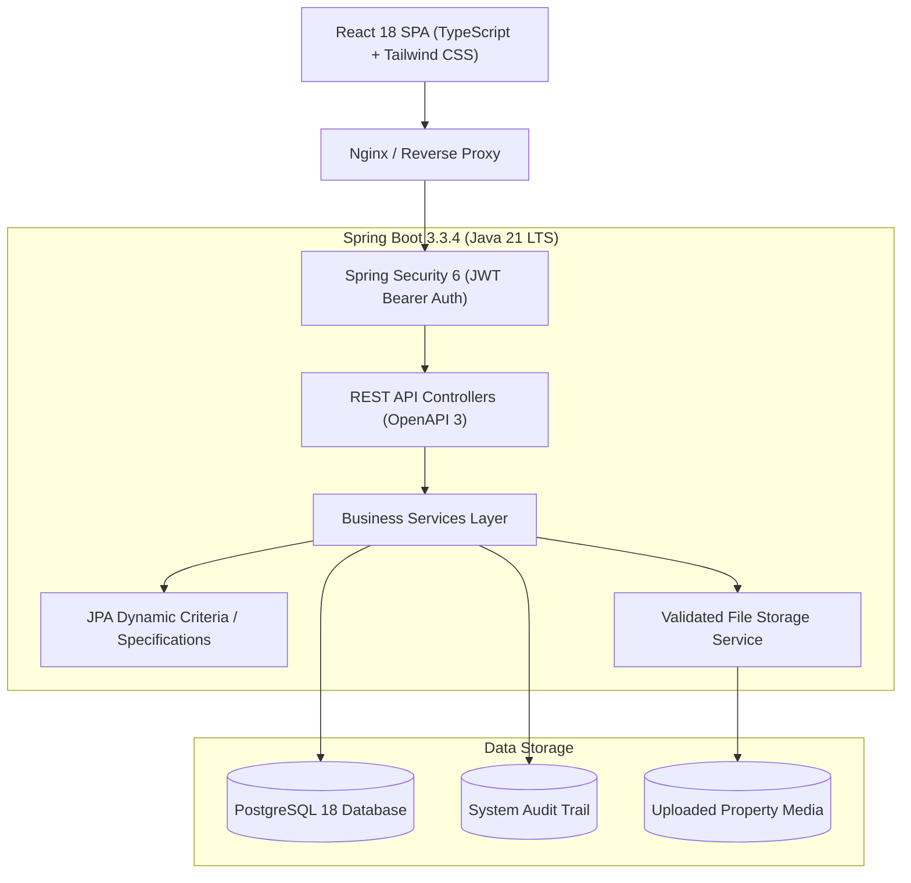

# EstateHub - Production-Ready Property Marketplace

[](https://www.oracle.com/java/)
[](https://spring.io/projects/spring-boot)
[](https://react.dev/)
[](https://www.typescriptlang.org/)
[](https://www.postgresql.org/)
[](https://tailwindcss.com/)

EstateHub is an enterprise-grade, multi-role real estate marketplace web application engineered with Spring Boot 3 (Java 21 LTS), React 18 (TypeScript + Vite + Tailwind CSS), and PostgreSQL. It delivers real-time property discovery, secure listing management, inquiry workflows, immutable audit trails, and an administrator moderation console.

---

## 1. Key Features

### 1. Distinct Portals & Multi-Role Architecture

EstateHub features three completely specialized, decoupled portals tailored to specific user workflows with distinct visual design systems:

1. **Client / Consumer & Owner Portal (`/portal/*`)**:
   - **Visual Style**: Clean Emerald & Stone consumer theme.
   - **Key Views**: Saved Wishlist (`/portal/favorites`), My Scheduled Tours & Walkthroughs (`/portal/showings`), Sent Inquiries (`/portal/inquiries`), My Listed Properties (`/portal/my-listings`), Post Property Listing Wizard (`/portal/submit-property`), and Account Profile (`/portal/profile`).
2. **Real Estate Agent CRM Portal (`/agent/*`)**:
   - **Visual Style**: High-density Deep Navy & Indigo brokerage cockpit.
   - **Key Views**: CRM Cockpit (`/agent/dashboard`), Interactive 6-stage Kanban Lead Pipeline (`/agent/pipeline`), Deals & Commission Tracker (`/agent/deals`), Client CRM Directory (`/agent/contacts`), Showings & Tour Calendar (`/agent/showings`), Property Portfolio (`/agent/listings`), Revenue Analytics (`/agent/analytics`), and Agent Credentials & Licensing (`/agent/profile`).
3. **Enterprise Admin Governance Portal (`/admin/*`)**:
   - **Visual Style**: Dark Charcoal & Amber executive command center.
   - **Key Views**: Platform KPIs & Telemetry (`/admin/dashboard`), Listing Moderation Queue (`/admin/moderation`) with mandatory rejection reasons, User Directory & Access Controls (`/admin/users`), Agent Verification & Licensing (`/admin/agents`), Abuse Reports Resolution (`/admin/reports`), and Immutable Audit Trail (`/admin/audit-logs`).
4. **Public Marketplace**:
   - Dynamic search, filters, interactive map, photo gallery, and direct **"Book Private Walkthrough"** widget seamlessly feeding into the Agent CRM lead engine.

---

## 2. Technology Stack

| Layer | Technologies |
|---|---|
| **Frontend** | React 18, TypeScript 5, Vite 5, Tailwind CSS, TanStack Query v5, React Router v6, Recharts, Lucide Icons |
| **Backend** | Java 21 LTS, Spring Boot 3.3.4, Spring Security 6, Spring Data JPA, Hibernate 6, Bean Validation |
| **Security** | Stateless JWT (JJWT 0.12.6), BCrypt Password Encoder (strength 12), Method Security (`@PreAuthorize`) |
| **Database** | PostgreSQL 18 / 16, Flyway Migrations (V1 Schema + V2 Master Seeds) |
| **DevOps** | Multi-Stage Dockerfiles (Temurin 21 + Nginx Alpine), Docker Compose, GitHub Actions CI/CD |

---

## 3. Architecture & Entity Overview



---

## 4. Default Seed & Demo Credentials

The platform initializes automatically with master categories, amenities, realistic sample properties, and demo accounts:

| Role | Email | Password | Access Area |
|---|---|---|---|
| **Platform Administrator** | `admin@estatehub.com` | `AdminSecure2026!` | Public + `/admin` Console |
| **Verified Agent** | `agent.john@estatehub.com` | `Agent1234!` | Public + `/dashboard` Portfolio |
| **Property Buyer** | `buyer.alice@estatehub.com` | `User1234!` | Public + `/dashboard` Favorites & Sent Leads |
| **Private Owner** | `owner.david@estatehub.com` | `Owner1234!` | Public + `/dashboard` Properties |

*(Note: In the login view, one-click demo login buttons are provided for instant evaluation.)*

---

## 5. Local Quickstart (Without Docker)

### Prerequisites
- Java 21 LTS
- Maven 3.9+
- Node.js 20+ and npm 10+
- PostgreSQL 14+ running on port 5432 (default db: `realestate_db`, user: `postgres`, password: `root`)

### 1. Database Setup
Create database in PostgreSQL:
```sql
CREATE DATABASE realestate_db;
```

### 2. Run Backend API
```bash
cd backend
mvn spring-boot:run
```
- Flyway migrations run automatically on startup (`V1__init_schema.sql` and `V2__seed_master_data.sql`).
- API starts at: `http://localhost:8080`
- Interactive OpenAPI / Swagger UI: `http://localhost:8080/swagger-ui/index.html`

### 3. Run Frontend SPA
```bash
cd frontend
npm install
npm run dev
```
- Frontend starts at: `http://localhost:5173`

---

## 6. Containerized Deployment with Docker Compose

Run the complete multi-service stack with a single command:
```bash
docker-compose up --build -d
```
Services initialized:
- **Frontend SPA**: `http://localhost:3000`
- **Backend API**: `http://localhost:8080`
- **PostgreSQL Database**: `localhost:5432`

To terminate containers:
```bash
docker-compose down
```

---

## 7. Automated Testing & Verification Evidence

### Backend Unit & Moderation Tests (JUnit 5 + Mockito)
Execute backend test suite:
```bash
mvn -f backend/pom.xml test
```
**Verified Results**:
- `AdminModerationTest`: 3 passed (Approve listing, reject listing with mandatory reason, demote last admin protection).
- `PropertyServiceTest`: 2 passed (Default `PENDING_REVIEW` lifecycle status, IDOR ownership enforcement).
- `UserServiceTest`: 3 passed (Registration, duplicate email handling, unprivileged role escalation defense).
- **Total: 8 tests executed, 0 failures, 0 errors.**

### Frontend Production Build (TypeScript + Vite)
Execute frontend build:
```bash
cd frontend && npm run build
```
**Verified Results**:
- TypeScript strict typecheck passed cleanly (`tsc -b`).
- Production bundles minified and emitted to `dist/` with gzip optimization.

---

## 8. REST API Summary Reference

| Method | Endpoint | Authority | Description |
|---|---|---|---|
| `POST` | `/api/v1/auth/register` | Public | Register new user or agent |
| `POST` | `/api/v1/auth/login` | Public | Authenticate user & issue JWT |
| `GET` | `/api/v1/auth/me` | Authenticated | Retrieve current user profile |
| `GET` | `/api/v1/properties` | Public | Multi-filter dynamic search with pagination |
| `GET` | `/api/v1/properties/{id}` | Public | Detailed property particulars |
| `GET` | `/api/v1/properties/featured`| Public | Homepage featured showcase |
| `POST` | `/api/v1/properties` | Auth | Create property listing (`PENDING_REVIEW`) |
| `PUT` | `/api/v1/properties/{id}` | Owner/Admin | Update property specifications |
| `PATCH` | `/api/v1/properties/{id}/status`| Owner/Admin | Transition status (`SOLD`, `RENTED`, etc.) |
| `POST` | `/api/v1/inquiries` | Public/Auth | Submit direct buyer inquiry / tour request |
| `GET` | `/api/v1/favorites` | Authenticated | Retrieve saved user favorites |
| `POST` | `/api/v1/favorites/{id}` | Authenticated | Save property to favorites |
| `GET` | `/api/v1/admin/dashboard` | Admin Only | Real-time aggregate platform statistics |
| `POST` | `/api/v1/admin/properties/{id}/approve` | Admin Only | Approve property to `PUBLISHED` |
| `POST` | `/api/v1/admin/properties/{id}/reject` | Admin Only | Reject property with mandatory rationale |
| `GET` | `/api/v1/admin/users` | Admin Only | Paginated user management directory |
| `GET` | `/api/v1/admin/audit-logs` | Admin Only | Query immutable system audit trail |
| `GET` | `/api/v1/crm/stats` | Agent/Admin | CRM pipeline summary metrics & deal math |
| `GET` | `/api/v1/crm/leads` | Agent/Admin | 6-stage Kanban lead directory |
| `PATCH`| `/api/v1/crm/leads/{id}/stage` | Agent/Admin | Transition lead pipeline stage |
| `GET` | `/api/v1/crm/deals` | Agent/Admin | Deals & commission tracker |
| `GET` | `/api/v1/crm/contacts` | Agent/Admin | Client contacts directory |
| `GET` | `/api/v1/crm/showings` | Agent/Admin | Agent showing & tour calendar |
| `POST`| `/api/v1/showings` | Authenticated | Book private walkthrough (auto-leads CRM) |
| `GET` | `/api/v1/showings/my` | Authenticated | Client's scheduled tours |
| `PATCH`| `/api/v1/showings/{id}/status` | Agent/Admin | Confirm / complete tour with client feedback |

---

## 9. Documentation Directory

Detailed specifications are maintained in the `docs/` folder:
- `docs/microservices-and-multi-portal-architecture.md`: Comprehensive microservice domains, 3 specialized portals, Kanban CRM, and tour scheduling engine.
- `docs/architecture.md`: Module boundaries, data flow diagrams, and threat models.
- `docs/database-schema.md`: Entity-relationship diagram, table columns, constraints, and indexes.
- `docs/api-specification.md`: Full REST endpoint schemas, query parameters, and error responses.
- `docs/security.md`: Authentication token lifecycle, RBAC enforcement, and vulnerability mitigations.
- `docs/deployment.md`: Operational production guide, environment variable template, and backup protocols.
- `docs/implementation-roadmap.md`: Architectural phase roadmap and task completion verification.
