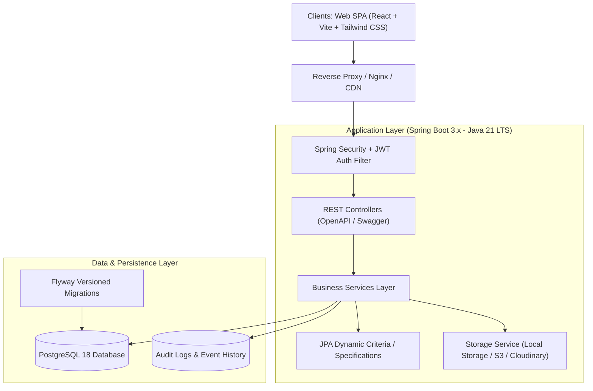

# EstateHub - Architecture Specification

## 1. Executive Summary & System Vision
**EstateHub** is an enterprise-grade, multi-role property marketplace engineered to connect property seekers (buyers/tenants), property owners, real estate agents, and platform administrators. Built on clean architecture principles, it guarantees end-to-end type safety, high availability, sub-100ms search latency, role-based access control (RBAC), and robust audit logging.

## 2. High-Level Architecture Diagram

## 3. Technology Stack & Component Versions

| Tier | Component | Selection | Version / Standard | Justification |
|------|-----------|-----------|--------------------|---------------|
| **Frontend** | Framework | React + TypeScript + Vite | React 18 / Vite 5 / TS 5 | Blazing fast build, strong typing, low footprint |
| **Frontend** | Styling | Tailwind CSS + Lucide Icons | v3.4 | Consistent design system, zero runtime overhead |
| **Frontend** | State & Data | TanStack Query v5 + Context API | v5.x | Server-state caching, automatic cache invalidation |
| **Frontend** | Forms & Validation | React Hook Form + Zod | v7.x / v3.x | Schema-driven client validation matching backend DTOs |
| **Frontend** | Visualization | Recharts | v2.x | Responsive SVG charts for Owner/Agent/Admin analytics |
| **Backend** | Runtime & Framework | Java 21 LTS + Spring Boot 3.3.4 | Java 21 / Spring Boot 3.3.4 | Long Term Support, virtual threads ready, modern Spring Security 6 |
| **Backend** | Security | Spring Security 6 + JJWT | JJWT 0.12.6 | Stateless JWT authentication, role hierarchy, ownership checks |
| **Backend** | Persistence | Spring Data JPA + Hibernate 6 | Hibernate 6.5+ | Specification-based dynamic multi-filter queries |
| **Backend** | Migration | Flyway Core | v10.x | Deterministic, version-controlled schema evolution |
| **Backend** | API Docs | Springdoc OpenAPI (Swagger UI) | v2.6.0 | Interactive API testing and live contract documentation |
| **Database** | RDBMS | PostgreSQL | 14+ / 18 | ACID compliance, JSONB capabilities, B-tree composite indices |
| **DevOps** | Containerization | Docker & Docker Compose | Multi-stage Dockerfiles | Reproducible isolated development and production deployment |

## 4. Subsystems & Module Boundaries

The backend adheres to a feature-driven modular structure:

1. **Authentication & Identity (`auth`, `user`, `security`)**:
   - Manages identity, BCrypt password hashing (strength 12), JWT issuance, verification, role-based authority mapping, and profile settings.
   - Initial bootstrap mechanism for System Administrator without hardcoded production credentials.
2. **Property Catalog & Search (`property`, `category`, `amenity`)**:
   - Full lifecycle management: `DRAFT` -> `PENDING_REVIEW` -> `PUBLISHED` -> `REJECTED` / `SUSPENDED` -> `SOLD` / `RENTED` -> `ARCHIVED`.
   - Dynamic parameter evaluation using Spring Data JPA `Specification` to eliminate N+1 issues and SQL injection risks.
3. **Media Management (`propertyimage`)**:
   - Multi-file multipart uploads, MIME-type and magic-number validation, random UUID storage key generation, thumbnail resolution, and local/S3 pluggable storage.
4. **Engagement & CRM (`inquiry`, `favorite`, `report`)**:
   - Inquiries between verified buyers/guests and property owners/agents with strict isolation (users can only access inquiries where they are sender or property owner).
   - User favorites tracking with unique constraints.
   - Property abuse and violation reporting with moderation queues.
5. **Auditing & Governance (`common.audit`, `admin`)**:
   - Platform-wide telemetry: user status toggles, moderation approvals/rejections with mandatory rationale, aggregate KPI calculation.

## 5. Security Architecture & Threat Model

- **Authentication Protocol**: Stateless Bearer JWT tokens with signed HMAC-SHA256 / SHA512 secrets.
- **Role Hierarchy**:
  - `ROLE_ADMIN` > `ROLE_AGENT` > `ROLE_USER` > `ROLE_GUEST`.
- **Method-Level Security**: `@PreAuthorize` annotations enforcing role checks and ownership validations (e.g., `#propertyService.isOwner(principal, #id)`).
- **Injection Defenses**:
  - SQL: 100% parameterized queries via Spring Data JPA and Hibernate Criteria Builder.
  - XSS: Content sanitization, React JSX escaping, and strict HTTP response security headers (`X-Content-Type-Options: nosniff`, `X-Frame-Options: DENY`, `Referrer-Policy: strict-origin-when-cross-origin`).
  - CSRF: Stateless Bearer architecture immune to traditional cookie CSRF; SameSite=Strict cookies used where applicable.
  - Path Traversal: Sanitized UUID keys for all uploaded media; no user-provided file paths are passed to underlying OS filesystems.

## 6. Performance & Scalability Strategy

- **Database Optimization**:
  - Composite indexes on `(status, transaction_type, city, price)`.
  - Covering indexes on foreign keys (`owner_id`, `property_id`).
- **Pagination**: Zero unbounded queries. All collection endpoints enforce standard `Pageable` limits (default 12, max 50).
- **Projections**: DTO projections (`PropertySummaryDTO`, `PropertyDetailDTO`) prevent serializing unwanted fields and lazy-initialization exceptions.
- **Frontend Performance**: Code splitting via React `lazy` and `Suspense`, debounced search inputs, image lazy-loading, and optimistic UI updates for favorites.
