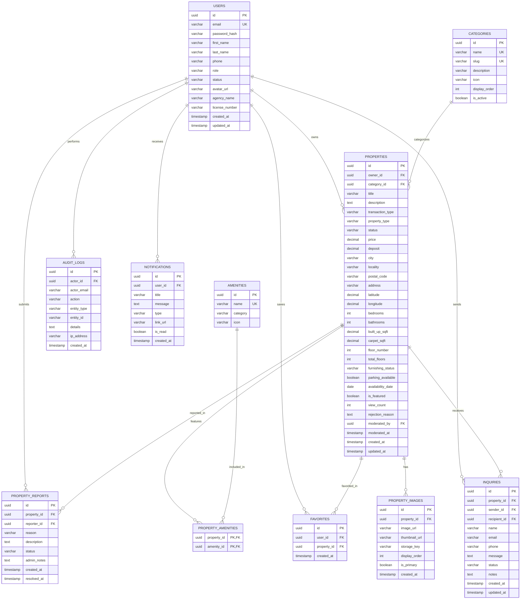

# EstateHub - Database Schema Specification

## 1. Overview
The database uses a normalized PostgreSQL schema engineered for transactional integrity, strict relational constraints, index-optimized multi-criteria search, and complete audit tracking.

## 2. Entity-Relationship Diagram (ERD)



## 3. Tables and Column Specifications

### 3.1. `users`
- `id`: `UUID PRIMARY KEY DEFAULT gen_random_uuid()`
- `email`: `VARCHAR(180) NOT NULL UNIQUE` (Normalized lowercase)
- `password_hash`: `VARCHAR(255) NOT NULL` (BCrypt encoded)
- `first_name`: `VARCHAR(80) NOT NULL`
- `last_name`: `VARCHAR(80) NOT NULL`
- `phone`: `VARCHAR(25)`
- `role`: `VARCHAR(20) NOT NULL` (`ROLE_USER`, `ROLE_AGENT`, `ROLE_ADMIN`)
- `status`: `VARCHAR(20) NOT NULL DEFAULT 'ACTIVE'` (`ACTIVE`, `SUSPENDED`, `PENDING_VERIFICATION`)
- `avatar_url`: `VARCHAR(512)`
- `agency_name`: `VARCHAR(150)` (For agents)
- `license_number`: `VARCHAR(100)` (For agents)
- `bio`: `TEXT`
- `created_at`: `TIMESTAMP WITH TIME ZONE NOT NULL DEFAULT NOW()`
- `updated_at`: `TIMESTAMP WITH TIME ZONE NOT NULL DEFAULT NOW()`

### 3.2. `property_categories`
- `id`: `UUID PRIMARY KEY DEFAULT gen_random_uuid()`
- `name`: `VARCHAR(80) NOT NULL UNIQUE`
- `slug`: `VARCHAR(80) NOT NULL UNIQUE`
- `description`: `VARCHAR(255)`
- `icon`: `VARCHAR(50)`
- `display_order`: `INT NOT NULL DEFAULT 0`
- `is_active`: `BOOLEAN NOT NULL DEFAULT TRUE`

### 3.3. `amenities`
- `id`: `UUID PRIMARY KEY DEFAULT gen_random_uuid()`
- `name`: `VARCHAR(80) NOT NULL UNIQUE`
- `category`: `VARCHAR(50)` (e.g., 'Indoor', 'Outdoor', 'Safety', 'Eco')
- `icon`: `VARCHAR(50)`

### 3.4. `properties`
- `id`: `UUID PRIMARY KEY DEFAULT gen_random_uuid()`
- `owner_id`: `UUID NOT NULL REFERENCES users(id) ON DELETE CASCADE`
- `category_id`: `UUID REFERENCES property_categories(id) ON DELETE SET NULL`
- `title`: `VARCHAR(200) NOT NULL`
- `description`: `TEXT NOT NULL`
- `transaction_type`: `VARCHAR(20) NOT NULL` (`SALE`, `RENT`)
- `property_type`: `VARCHAR(30) NOT NULL` (`APARTMENT`, `HOUSE`, `VILLA`, `PLOT`, `COMMERCIAL`, `OFFICE`, `SHOP`, `OTHER`)
- `status`: `VARCHAR(30) NOT NULL DEFAULT 'PENDING_REVIEW'` (`DRAFT`, `PENDING_REVIEW`, `PUBLISHED`, `REJECTED`, `SUSPENDED`, `SOLD`, `RENTED`, `ARCHIVED`)
- `price`: `NUMERIC(14,2) NOT NULL CHECK (price >= 0)`
- `deposit`: `NUMERIC(14,2) DEFAULT 0 CHECK (deposit >= 0)`
- `city`: `VARCHAR(100) NOT NULL`
- `locality`: `VARCHAR(120) NOT NULL`
- `postal_code`: `VARCHAR(20)`
- `address`: `VARCHAR(255) NOT NULL`
- `latitude`: `NUMERIC(10,7)`
- `longitude`: `NUMERIC(10,7)`
- `bedrooms`: `INT NOT NULL DEFAULT 0 CHECK (bedrooms >= 0)`
- `bathrooms`: `INT NOT NULL DEFAULT 0 CHECK (bathrooms >= 0)`
- `built_up_sqft`: `NUMERIC(10,2) CHECK (built_up_sqft > 0)`
- `carpet_sqft`: `NUMERIC(10,2)`
- `floor_number`: `INT`
- `total_floors`: `INT`
- `furnishing_status`: `VARCHAR(30)` (`UNFURNISHED`, `SEMI_FURNISHED`, `FULLY_FURNISHED`)
- `parking_available`: `BOOLEAN DEFAULT FALSE`
- `availability_date`: `DATE`
- `is_featured`: `BOOLEAN NOT NULL DEFAULT FALSE`
- `view_count`: `BIGINT NOT NULL DEFAULT 0`
- `rejection_reason`: `TEXT`
- `moderated_by`: `UUID REFERENCES users(id)`
- `moderated_at`: `TIMESTAMP WITH TIME ZONE`
- `created_at`: `TIMESTAMP WITH TIME ZONE NOT NULL DEFAULT NOW()`
- `updated_at`: `TIMESTAMP WITH TIME ZONE NOT NULL DEFAULT NOW()`

### 3.5. `property_images`
- `id`: `UUID PRIMARY KEY DEFAULT gen_random_uuid()`
- `property_id`: `UUID NOT NULL REFERENCES properties(id) ON DELETE CASCADE`
- `image_url`: `VARCHAR(512) NOT NULL`
- `thumbnail_url`: `VARCHAR(512)`
- `storage_key`: `VARCHAR(255) NOT NULL`
- `display_order`: `INT NOT NULL DEFAULT 0`
- `is_primary`: `BOOLEAN NOT NULL DEFAULT FALSE`
- `created_at`: `TIMESTAMP WITH TIME ZONE NOT NULL DEFAULT NOW()`

### 3.6. `property_amenities` (Junction Table)
- `property_id`: `UUID NOT NULL REFERENCES properties(id) ON DELETE CASCADE`
- `amenity_id`: `UUID NOT NULL REFERENCES amenities(id) ON DELETE CASCADE`
- `PRIMARY KEY (property_id, amenity_id)`

### 3.7. `favorites`
- `id`: `UUID PRIMARY KEY DEFAULT gen_random_uuid()`
- `user_id`: `UUID NOT NULL REFERENCES users(id) ON DELETE CASCADE`
- `property_id`: `UUID NOT NULL REFERENCES properties(id) ON DELETE CASCADE`
- `created_at`: `TIMESTAMP WITH TIME ZONE NOT NULL DEFAULT NOW()`
- `CONSTRAINT uq_user_favorite UNIQUE (user_id, property_id)`

### 3.8. `inquiries`
- `id`: `UUID PRIMARY KEY DEFAULT gen_random_uuid()`
- `property_id`: `UUID NOT NULL REFERENCES properties(id) ON DELETE CASCADE`
- `sender_id`: `UUID REFERENCES users(id) ON DELETE SET NULL`
- `recipient_id`: `UUID NOT NULL REFERENCES users(id) ON DELETE CASCADE`
- `name`: `VARCHAR(100) NOT NULL`
- `email`: `VARCHAR(180) NOT NULL`
- `phone`: `VARCHAR(25)`
- `message`: `TEXT NOT NULL`
- `status`: `VARCHAR(25) NOT NULL DEFAULT 'NEW'` (`NEW`, `CONTACTED`, `RESOLVED`, `CLOSED`)
- `notes`: `TEXT`
- `created_at`: `TIMESTAMP WITH TIME ZONE NOT NULL DEFAULT NOW()`
- `updated_at`: `TIMESTAMP WITH TIME ZONE NOT NULL DEFAULT NOW()`

### 3.9. `property_reports`
- `id`: `UUID PRIMARY KEY DEFAULT gen_random_uuid()`
- `property_id`: `UUID NOT NULL REFERENCES properties(id) ON DELETE CASCADE`
- `reporter_id`: `UUID REFERENCES users(id) ON DELETE SET NULL`
- `reason`: `VARCHAR(100) NOT NULL`
- `description`: `TEXT NOT NULL`
- `status`: `VARCHAR(25) NOT NULL DEFAULT 'PENDING'` (`PENDING`, `INVESTIGATING`, `RESOLVED`, `DISMISSED`)
- `admin_notes`: `TEXT`
- `created_at`: `TIMESTAMP WITH TIME ZONE NOT NULL DEFAULT NOW()`
- `resolved_at`: `TIMESTAMP WITH TIME ZONE`

### 3.10. `notifications`
- `id`: `UUID PRIMARY KEY DEFAULT gen_random_uuid()`
- `user_id`: `UUID NOT NULL REFERENCES users(id) ON DELETE CASCADE`
- `title`: `VARCHAR(150) NOT NULL`
- `message`: `TEXT NOT NULL`
- `type`: `VARCHAR(50) NOT NULL` (`INQUIRY_RECEIVED`, `PROPERTY_APPROVED`, `PROPERTY_REJECTED`, `SYSTEM`)
- `link_url`: `VARCHAR(255)`
- `is_read`: `BOOLEAN NOT NULL DEFAULT FALSE`
- `created_at`: `TIMESTAMP WITH TIME ZONE NOT NULL DEFAULT NOW()`

### 3.11. `audit_logs`
- `id`: `UUID PRIMARY KEY DEFAULT gen_random_uuid()`
- `actor_id`: `UUID REFERENCES users(id) ON DELETE SET NULL`
- `actor_email`: `VARCHAR(180)`
- `action`: `VARCHAR(100) NOT NULL` (e.g., `PROPERTY_APPROVED`, `USER_SUSPENDED`, `ROLE_UPDATED`)
- `entity_type`: `VARCHAR(50) NOT NULL`
- `entity_id`: `VARCHAR(100) NOT NULL`
- `details`: `TEXT`
- `ip_address`: `VARCHAR(45)`
- `created_at`: `TIMESTAMP WITH TIME ZONE NOT NULL DEFAULT NOW()`

## 4. Search and Composite Indexes

```sql
-- Search & Filtering Optimization Indexes
CREATE INDEX idx_properties_status ON properties(status);
CREATE INDEX idx_properties_public_search ON properties(status, transaction_type, city, price) WHERE status = 'PUBLISHED';
CREATE INDEX idx_properties_owner_id ON properties(owner_id);
CREATE INDEX idx_properties_category_id ON properties(category_id);
CREATE INDEX idx_properties_is_featured ON properties(is_featured) WHERE is_featured = TRUE;
CREATE INDEX idx_properties_created_at ON properties(created_at DESC);

-- Inquiry & Favorites Indexes
CREATE INDEX idx_inquiries_recipient ON inquiries(recipient_id, created_at DESC);
CREATE INDEX idx_inquiries_sender ON inquiries(sender_id, created_at DESC);
CREATE INDEX idx_inquiries_property ON inquiries(property_id);
CREATE INDEX idx_favorites_user ON favorites(user_id);
CREATE INDEX idx_favorites_property ON favorites(property_id);

-- User Indexes
CREATE INDEX idx_users_email ON users(email);
CREATE INDEX idx_users_role ON users(role);
CREATE INDEX idx_users_status ON users(status);

-- Image Indexes
CREATE INDEX idx_property_images_property ON property_images(property_id, display_order ASC);
```
