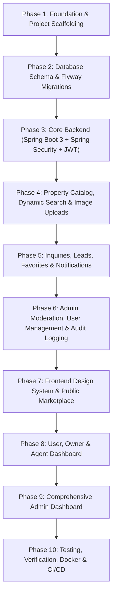

# EstateHub - Implementation Roadmap & Task Board

## 1. Execution Strategy & Specialized Agent Roles

This project is executed sequentially across 10 specialized functional roles:
1. **Architecture Agent**: Blueprinting module contracts, system boundaries, schemas, and API contracts. (Completed)
2. **Database Agent**: PostgreSQL schema, Flyway migrations, indexing, and seed data.
3. **Backend Agent**: Spring Boot 3.3.4 + Java 21 services, controllers, specifications, and storage.
4. **Authentication & Security Agent**: Spring Security 6, JWT, password encoders, RBAC, ownership checks.
5. **UI/UX & Frontend Agent**: Tailwind design system, responsive layouts, components, public pages.
6. **Dashboard Agent**: User/Agent dashboard, listing creation/editing, inquiries, leads, favorites.
7. **Admin Dashboard Agent**: Moderation portal, user management, audit logs, and reports.
8. **Testing Agent**: Integration and unit testing, endpoint verification, edge case testing.
9. **DevOps Agent**: Docker Compose, multi-stage Dockerfiles, GitHub Actions CI/CD pipeline, env samples.
10. **Code Review & QA Agent**: End-to-end integration verification, security audit, and documentation.

---

## 2. Phase Breakdown

---

## 3. Detailed Task Board

### Phase 1: Foundation & Project Scaffolding
- [x] Initial repository inspection and environment audit.
- [x] Architecture design (`docs/architecture.md`).
- [x] Database schema & ERD (`docs/database-schema.md`).
- [x] REST API specification (`docs/api-specification.md`).
- [x] Implementation roadmap (`docs/implementation-roadmap.md`).
- [ ] Maven backend project structure (`backend/pom.xml`, directories).
- [ ] Vite + React + TypeScript + Tailwind CSS frontend structure (`frontend/`).

### Phase 2: Database Schema & Migrations
- [ ] Flyway migration `V1__init_schema.sql` (Tables, constraints, foreign keys, indexes).
- [ ] Flyway migration `V2__seed_master_data.sql` (Categories, amenities, bootstrap admin).
- [ ] Verify migration execution on PostgreSQL 18.

### Phase 3: Core Backend & Security
- [ ] Spring Boot application configuration (`application.yml`).
- [ ] Global exception handling & standard error format.
- [ ] Security configuration, JWT token provider, filter, UserPrincipal.
- [ ] User entity, repository, service, and auth endpoints (`/auth/register`, `/auth/login`, `/auth/me`).
- [ ] Verify auth endpoints with real DB persistence.

### Phase 4: Property Catalog & Media Storage
- [ ] Property entity, category entity, amenity entity, image entity.
- [ ] Property specification for multi-filter search.
- [ ] PropertyService with complete lifecycle transitions (`DRAFT`, `PENDING_REVIEW`, `PUBLISHED`, `REJECTED`, etc.).
- [ ] Local storage service with validation for property images.
- [ ] Public and protected property endpoints.

### Phase 5: CRM, Inquiries, Favorites, Notifications
- [ ] Inquiry workflow & data isolation between sender/recipient.
- [ ] Favorite management (add, remove, list).
- [ ] Notification service & dispatch on key triggers.
- [ ] Report submission service.

### Phase 6: Admin Portal APIs & Audit
- [ ] Moderation endpoints (approve, reject with reason, suspend, restore).
- [ ] User management (status toggle, role modification).
- [ ] Immutable audit log recording for privileged operations.
- [ ] Real aggregate dashboard metrics & analytics.

### Phase 7: Frontend Design System & Public Marketplace
- [ ] Tailwind CSS configuration, design tokens, color palette.
- [ ] Reusable components (Navbar, Footer, PropertyCard, SearchBar, StatusBadge, Modal, Toast).
- [ ] Home page with hero, search, featured listings, categories, stats.
- [ ] Property listing page with grid/list view, filter drawer, pagination, URL search params sync.
- [ ] Property detail page with gallery, details, owner card, inquiry modal, favorite toggle.
- [ ] Auth pages (Login, Register).

### Phase 8: User & Agent Dashboard
- [ ] Dashboard layout with sidebar navigation.
- [ ] Overview with real statistical cards and quick actions.
- [ ] "My Properties" listing with status badges and action dropdowns.
- [ ] Add/Edit Property wizard with image upload, categories, amenities.
- [ ] Inquiries inbox (Sent & Received) with status update workflow.
- [ ] Saved Favorites page.
- [ ] Profile & security settings.

### Phase 9: Admin Dashboard
- [ ] Admin layout with security guard (Admin role required).
- [ ] Platform overview KPIs (users, properties, inquiries, pending approvals).
- [ ] Property moderation queue (approve/reject with mandatory reason dialog).
- [ ] User management table (suspend/activate, role assignment).
- [ ] Audit logs viewer with search and filter.
- [ ] Platform reports and inquiry monitoring.

### Phase 10: Testing, Verification & DevOps
- [ ] Backend unit & integration tests.
- [ ] Frontend build verification (`npm run build`).
- [ ] Multi-stage Dockerfile for Backend (Java 21).
- [ ] Multi-stage Dockerfile for Frontend (Node/Nginx).
- [ ] `docker-compose.yml` for unified local execution.
- [ ] `.github/workflows/ci.yml` CI/CD pipeline.
- [ ] Operational docs (`docs/deployment.md`, `docs/security.md`, `README.md`).
- [ ] Final verification of all user journeys.
