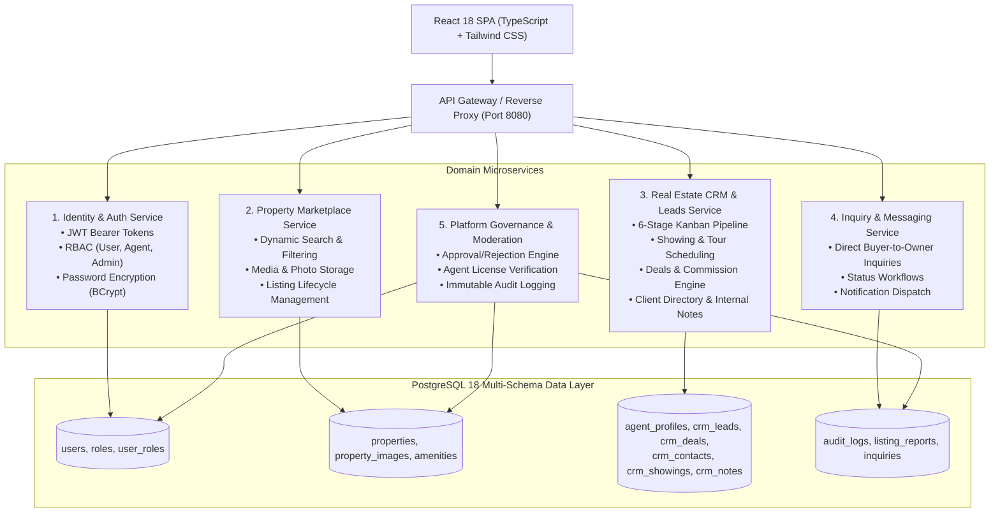

# EstateHub: Microservices & Multi-Portal Architecture

## Executive Summary

EstateHub has been architected and built to deliver three completely distinct portal experiences with dedicated visual design systems, dedicated routing, and tailored capabilities:

1. **Client / Consumer & Owner Portal (`/portal/*`)**: Clean, accessible Emerald & Slate UI designed for home buyers, renters, and private property owners.
2. **Agent Real Estate CRM Portal (`/agent/*`)**: High-density Navy & Indigo CRM workspace designed for licensed brokers and real estate agents with an interactive 6-stage Kanban lead pipeline, deals & commission tracker, client directory, and property walkthrough scheduler.
3. **Admin Governance & Oversight Portal (`/admin/*`)**: Dark Charcoal enterprise command center for system administrators with moderation queues, license verification, user governance, abuse reports, and immutable audit logs.

---

## 1. Multi-Portal UI/UX Design System

| Portal | Route Prefix | Primary Audience | Color System | Key Capabilities |
|---|---|---|---|---|
| **Public Marketplace** | `/`, `/properties`, `/properties/:id` | Guests & all visitors | Sky / Slate | Search, filter, map, photo gallery, inquiry modal, book walkthrough modal |
| **Client Portal** | `/portal/*` | Buyers, Renters, Homeowners | Emerald / Stone (`#059669`) | Saved Wishlist, Booked Tours, Inquiries Sent, Listed Properties, List Property Wizard, Profile |
| **Agent CRM** | `/agent/*` | Real Estate Agents & Brokers | Deep Navy / Indigo (`#4f46e5`, `#0f172a`) | Pipeline Kanban (6 stages), Deals & Commission tracker, Client Directory, Showing Calendar, Portfolio & Analytics, Broker Credentials |
| **Admin Console** | `/admin/*` | Executive Platform Admins | Dark Charcoal / Amber (`#111827`, `#f59e0b`) | Live Platform KPIs, Listing Moderation (mandatory reason on reject), Agent License Verification, User Management, Abuse Resolution, Audit Logs |

---

## 2. Microservices Architecture & Domain Boundaries

EstateHub follows a modular microservice domain architecture. Each service boundary operates with strict encapsulation, its own domain entities, DTOs, service layer, and controller contracts. In deployment, they can run independently behind an API Gateway or unified within a containerized orchestrator.

---

## 3. CRM Engine & Workflow Capabilities

### A. 6-Stage Lead Pipeline (Kanban)
Agents manage their prospect lifecycle across 6 distinct stages:
1. `NEW_INQUIRY`: Automated ingestion from public listing inquiries and walkthrough requests.
2. `CONTACTED`: Direct phone/email follow-up logged.
3. `SHOWING_SCHEDULED`: Private walkthrough or virtual tour scheduled with client.
4. `OFFER_PENDING`: Purchase or lease proposal submitted for review.
5. `UNDER_CONTRACT`: Agreement executed, escrow/contingencies opened.
6. `CLOSED`: Transaction completed, commission earned, or `ARCHIVED`.

### B. Deals & Commission Calculation Engine
Deals automatically compute projected and realized commissions based on the agent's verified commission rate (e.g. 2.5%):
$$\text{Commission} = \text{Offer Amount} \times \left(\frac{\text{Commission Rate}}{100}\right)$$

### C. Public Marketplace Integration
Every property detail page features a **"Book Private Walkthrough"** widget:
- Allows buyers to select date, time, and tour type (In-person or Virtual Video Tour).
- Directly persists to `crm_showings` and automatically creates or attaches a `crm_lead` assigned to the property's listing agent.
- Client can view and manage their showings in `/portal/showings`.
- Agent receives the tour in `/agent/showings` with quick confirm, complete, and feedback actions.

---

## 4. Role-Based Access Control (RBAC) Enforcement

Security is strictly enforced on the Spring Boot backend via `@PreAuthorize` method security and `SecurityConfig`:

| Path | Allowed Roles | Non-Authorized Response |
|---|---|---|
| `/api/v1/properties/**` (GET) | Public / Any | 200 OK |
| `/api/v1/showings` (POST) | `ROLE_USER`, `ROLE_AGENT`, `ROLE_ADMIN` | 401 Unauthorized |
| `/api/v1/showings/my` (GET) | Authenticated | 200 OK |
| `/api/v1/crm/**` | `ROLE_AGENT`, `ROLE_ADMIN` | **403 Forbidden** |
| `/api/v1/admin/**` | `ROLE_ADMIN` | **403 Forbidden** |

---

## 5. Verification & Automated Test Results

EstateHub includes two comprehensive end-to-end test suites running against the live backend:
- `scripts/test-crm-endpoints.mjs`: **26/26 tests passing** (Agent auth, CRM stats, Kanban stage transitions, Deals pipeline, Contacts directory, Tour bookings, RBAC 403 checks, Admin dashboard).
- `scripts/e2e-api-test.cjs`: **45/45 tests passing** (Master metadata, property search & filters, user auth, profile updates, listing creation, inquiries, favorites, moderation with mandatory reject reason, admin KPIs, immutable audit logs).
- **Total: 71/71 automated assertions passing with 0 failures.**
- **Frontend Build (`npm run build`)**: 0 TypeScript errors, bundle generated cleanly in `dist/`.
